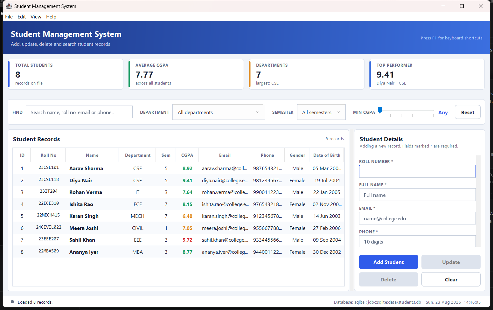
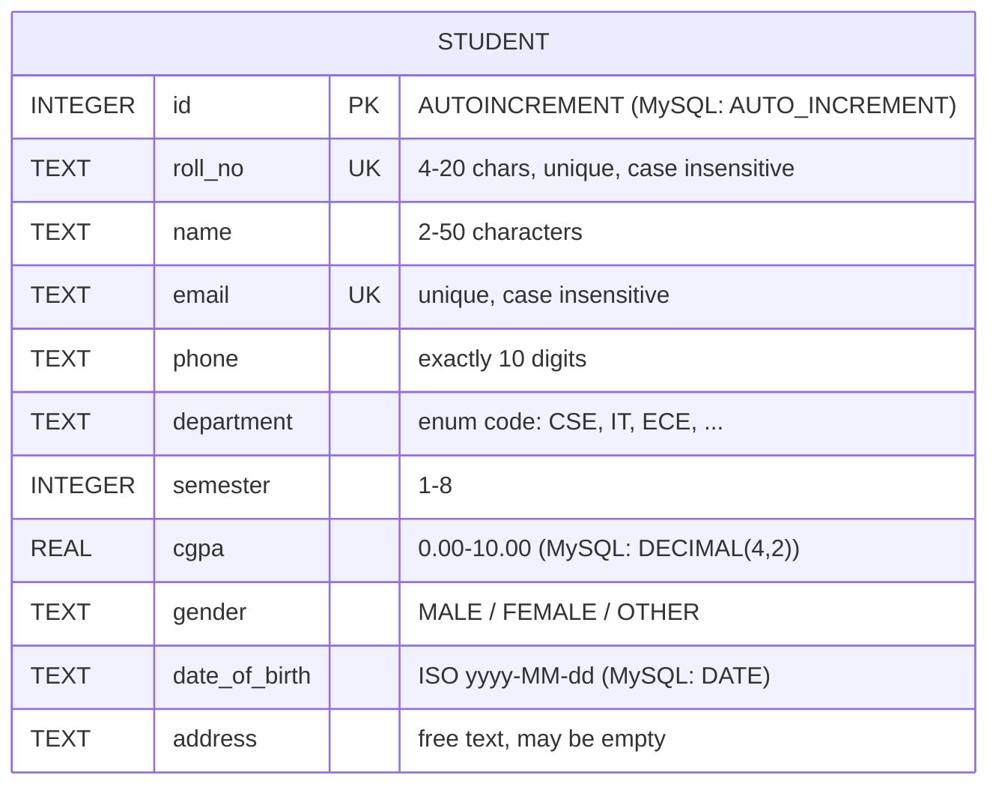
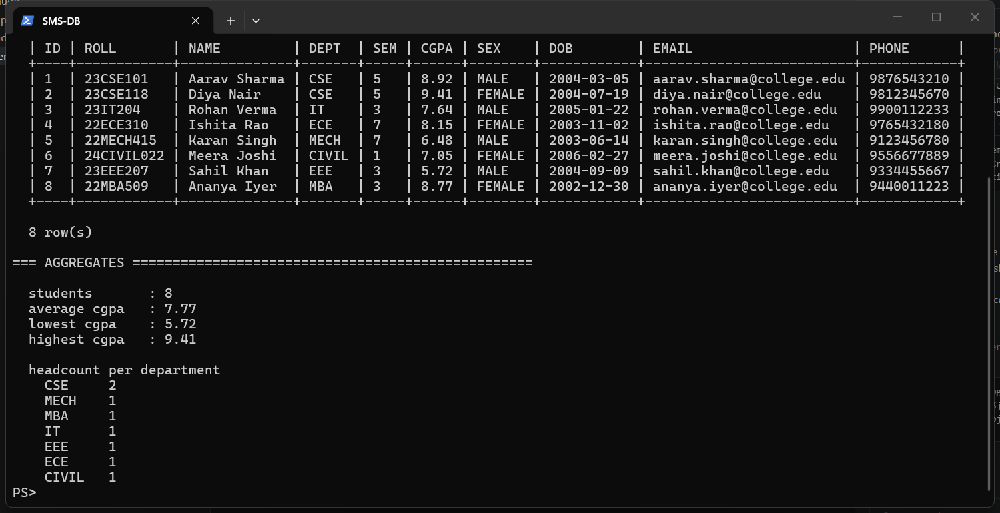
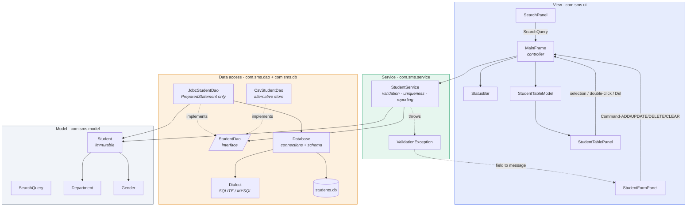
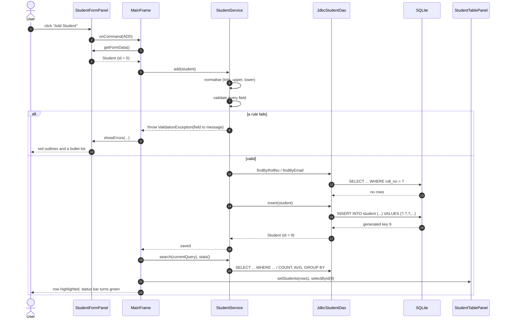

# Student Management System

A desktop CRUD application built with **Java Swing / AWT** on top of a **SQLite database
accessed through JDBC**. It adds, updates, deletes and searches student records, and reports on
them through a small dashboard. No frameworks, no build tool, no ORM: the only dependency is the
JDBC driver jar.

The database is SQLite so the project runs anywhere with zero setup. Nothing in the code is
SQLite specific: switching to MySQL is an edit to `db.properties` plus one jar, and is described
at the end of this file.



*Gradient banner, dashboard tiles, live search bar, sortable grid, the data-entry form, and a
status bar showing the last action, the live database connection and a clock.*

---

## Quick start

**Requirements:** JDK 8 or newer (`javac` and `java` on your `PATH`). Nothing else. The JDBC
driver already sits in `lib/`; if that folder is empty run `setup.bat` once to download it.

```bat
:: Windows
run.bat                 :: compile and launch
test.bat                :: compile and run the test suite
inspect.bat             :: print what is actually inside the database
build.bat               :: compile only
setup.bat               :: download the JDBC driver into lib\ (one time)
```

```bash
# macOS / Linux
chmod +x run.sh
./run.sh                # compile and launch
./run.sh --test         # run the test suite
./run.sh --setup        # download the JDBC driver into lib/
```

The database file is created at `data/students.db` on first run and seeded with eight demo
students. Useful variations:

```bat
run.bat --db C:\path\to\other.db    :: a different SQLite file
run.bat --csv data\students.csv     :: the alternative CSV store, see "Two stores" below
```

> **No JDK yet?** Install [Temurin JDK 21](https://adoptium.net/), or run
> `winget install EclipseAdoptium.Temurin.21.JDK`, then open a new terminal and run `run.bat`.

---

## Features

| | |
|---|---|
| **Create** | Every field validated; all problems reported at once, with the offending inputs outlined in red. |
| **Read** | Sortable, zebra striped grid. Click any header to sort; numbers and dates sort correctly rather than alphabetically. |
| **Update** | Select a row, or double click it, to load it into the form. `Update` writes it back. |
| **Delete** | Multi select rows and press `Delete`. The confirmation names exactly what will be removed, and the batch is deleted inside one transaction. |
| **Search** | Live filtering as you type, pushed down into a parameterised SQL `WHERE` clause, combined with department, semester and minimum CGPA filters. |
| **Dashboard** | Head count, average CGPA, active departments and current topper, each a single aggregate query, recomputed after every change. |
| **Export** | Writes whatever the grid is currently showing to a CSV file of your choice. |
| **Inspect** | `inspect.bat` prints the driver, the table definition, every row and the aggregates, so you can see the real database contents without any extra tool. |
| **Keyboard** | Mnemonics on every menu, accelerators for every command, `Delete` on the grid, `Esc` to reset. |

---

## The database



The table is created on first run by `CREATE TABLE IF NOT EXISTS`, so there is no migration step
and no schema file to apply by hand. The `UNIQUE` constraints on `roll_no` and `email` are the
real guarantee behind the duplicate checks: the service checks first so the user gets a friendly
message, and the database refuses regardless. There is a test for exactly that.

Here is the database after a first run, printed by `inspect.bat`:



The same output in text form is kept at [docs/database-dump.txt](docs/database-dump.txt).

---

## Architecture

Four layers, one dependency direction. The Swing package never imports a DAO or JDBC type, and
nothing below the UI imports Swing. That single rule is what lets 134 assertions run headlessly
against real business logic.



### What happens when you press *Add*



---

## JDBC concepts, and where to read them

| Concept | Where | Note |
|---|---|---|
| `DriverManager.getConnection` | [Database.java](src/com/sms/db/Database.java) | One place opens connections; every caller uses try-with-resources. |
| Driver discovery | Database.java | JDBC 4 finds the driver on the classpath. `db.driver` forces `Class.forName` only for older setups. |
| `CREATE TABLE IF NOT EXISTS` | [Dialect.java](src/com/sms/db/Dialect.java) | Schema created at start-up, safe to re-run. |
| `PreparedStatement` for every value | [JdbcStudentDao.java](src/com/sms/dao/JdbcStudentDao.java) | No user input is ever concatenated into SQL, including in the dynamic search. |
| Parameterised **dynamic** SQL | `JdbcStudentDao.search` | Clause text is built from constants, values travel as bound parameters. |
| `Statement.RETURN_GENERATED_KEYS` | `JdbcStudentDao.insert` | The database assigns the id; the app reads it back. |
| `ResultSet` to object mapping | `JdbcStudentDao.read` | Columns read by name, not by index, so column order changes cannot break it. |
| Aggregates: `COUNT`, `AVG`, `GROUP BY`, `ORDER BY ... LIMIT` | `JdbcStudentDao` | The dashboard is four aggregate queries, not a scan in Java. |
| Transactions: `setAutoCommit(false)`, `commit`, `rollback` | `JdbcStudentDao.deleteMany` | A multi-row delete is all or nothing. |
| try-with-resources on `Connection`, `Statement`, `ResultSet` | throughout | The classic way a JDBC app leaks and then dies. |
| `SQLException` translation | `JdbcStudentDao.translate` | Vendor codes never escape the DAO; callers see a readable sentence. |
| `DatabaseMetaData`, `ResultSetMetaData` | [DbInspector.java](src/com/sms/db/DbInspector.java) | Used to print the driver and the column layout portably. |
| Unique constraint handling | Dialect.java | SQLite reports error code 19, MySQL reports 1062 / SQLState 23000. Both are recognised. |

---

## Swing concepts, and where to read them

### Components

| Component | Where | Why it was chosen |
|---|---|---|
| `JFrame`, `JMenuBar`, `JMenu`, `JMenuItem` | [MainFrame.java](src/com/sms/ui/MainFrame.java) | Standard window chrome; every command also lives in a menu with a mnemonic and an accelerator. |
| `JSplitPane` | MainFrame | Lets the user trade grid width for form width at runtime. |
| `JTable` with `AbstractTableModel` | [StudentTablePanel.java](src/com/sms/ui/StudentTablePanel.java), [StudentTableModel.java](src/com/sms/ui/StudentTableModel.java) | The right control for tabular records; a custom model holds `Student` objects rather than `Object[][]`. |
| `TableRowSorter` | StudentTablePanel | Click to sort for free; `getColumnClass` makes CGPA sort numerically and dates chronologically. |
| `DefaultTableCellRenderer` | [TableRenderers.java](src/com/sms/ui/renderer/TableRenderers.java) | Zebra rows, monospaced roll numbers, CGPA coloured by band. |
| `JTextField` subclassed as `HintTextField` | [HintTextField.java](src/com/sms/ui/components/HintTextField.java) | Placeholder painted, not inserted, so `getText()` never returns the hint. |
| `JComboBox` | Form and search bar | Constrained choice for department and semester, so invalid input is impossible. |
| `JRadioButton` with `ButtonGroup` | Form | Three mutually exclusive options read faster than a dropdown. |
| `JSpinner` with `SpinnerDateModel` | Form | Date entry that cannot produce `32-13-2004`. |
| `JTextArea` in a `JScrollPane` | Form | Multi-line address. |
| `JSlider` | [SearchPanel.java](src/com/sms/ui/SearchPanel.java) | A CGPA threshold is a range, so a slider beats a text box. |
| `JOptionPane` | [Dialogs.java](src/com/sms/ui/Dialogs.java) | Confirmations and errors, wrapped so every dialog reads the same. |
| `JFileChooser` with `FileNameExtensionFilter` | MainFrame | CSV export. |
| `javax.swing.Timer` | [StatusBar.java](src/com/sms/ui/StatusBar.java) | A clock that ticks on the EDT rather than on a raw `Thread`. |
| Custom `JComponent` painting | `ActionButton`, `CardPanel`, `StatTile`, `GradientPanel` | Rounded buttons, cards and the banner gradient, drawn with `Graphics2D` and antialiasing. |

### Layout managers

| Manager | Where | Why |
|---|---|---|
| `BorderLayout` | Frame content and every panel skeleton | One stretchy centre with fixed edges, which is the shape of this window. |
| `GridBagLayout` | [StudentFormPanel.java](src/com/sms/ui/StudentFormPanel.java), SearchPanel | The only manager that can put labels above fields, make one row two half width cells, and let the address box absorb the leftover height. |
| `GridLayout` | Dashboard row, the two by two button block | Equal sized cells, no constraints needed. |
| `FlowLayout` | Status bar clusters | Natural left and right runs of small components. |
| `BoxLayout` | `StatTile`, the empty state | Vertical stacking with glue for centring. |
| `CardLayout` | StudentTablePanel | Swaps the grid for an empty state panel when a search returns nothing. |

### Event handling

| Mechanism | Where | Effect |
|---|---|---|
| `ActionListener` | Buttons, menu items, combo boxes | Commands and filter changes. |
| `DocumentListener` | Search field | Live search: results narrow on every keystroke, with no Search button. |
| `ListSelectionListener` | Table selection model | Selecting a row loads it into the form, guarded by `getValueIsAdjusting`. |
| `MouseAdapter` | Table | Double click loads a row and focuses the form. |
| `ChangeListener` | CGPA slider | Updates the label live, re-queries only when the drag ends. |
| `FocusAdapter` | Every input | Blue focus outline, red error outline that survives focus loss. |
| `WindowAdapter` | Frame | `DO_NOTHING_ON_CLOSE` plus a confirmation before exit, and initial focus on open. |
| `InputMap` / `ActionMap` | Root pane, table | `Esc` and `Delete` key bindings, the modern replacement for `KeyListener`. |
| Custom listener interfaces | `CommandListener`, `Consumer<SearchQuery>`, `Consumer<Student>` | Panels stay decoupled: they announce, `MainFrame` decides. |

---

## Validation rules

Enforced in [StudentService](src/com/sms/service/StudentService.java), never in the UI, so any
future importer or web front end gets the same guarantees.

| Field | Rule |
|---|---|
| Roll number | Required, 4 to 20 characters of `A-Z 0-9 - /`, unique (case insensitive) |
| Name | Required, 2 to 50 letters, plus space `.` `'` `-` |
| Email | Required, `local@domain.tld`, unique (case insensitive) |
| Phone | Required, exactly 10 digits after stripping spaces, dashes and brackets |
| Department | Required, one of seven enum values |
| Semester | 1 to 8 |
| CGPA | 0.00 to 10.00 |
| Date of birth | Required, in the past, resulting age 14 to 80 |
| Address | Optional free text |

Input is **normalised before validation**: names get their extra spaces collapsed, roll numbers
are upper cased, emails lower cased, phones reduced to digits. So `" 23cse101 "` and `"23CSE101"`
are correctly detected as the same student, both by the service and by the unique index.

---

## Two stores, one interface

`StudentService` depends on the `StudentDao` interface, never on a concrete class. Two
implementations ship:

* **`JdbcStudentDao`** is the real one, backed by SQLite or MySQL. This is the default.
* **`CsvStudentDao`** keeps the table in a `LinkedHashMap` mirrored to a UTF-8 CSV file. Run it
  with `run.bat --csv data\students.csv`.

The CSV store is not decoration. It is the proof that the layering works: the service, the
validation, the dashboard and every Swing panel run unchanged on top of it, and the test suite
runs one scenario through **both** implementations and asserts they return identical answers.
If a SQL query and the in-memory rules ever disagree, that test fails.

---

## Project layout

```
StudentManagementSystem/
├── src/com/sms/
│   ├── Main.java                     entry point, wiring, EDT bootstrap
│   ├── model/                        Student, SearchQuery, Department, Gender
│   ├── db/
│   │   ├── Database.java             connections, config, schema creation
│   │   ├── Dialect.java              SQLite and MySQL differences, in one place
│   │   └── DbInspector.java          prints the live database contents
│   ├── dao/
│   │   ├── StudentDao.java           the interface everything above depends on
│   │   ├── JdbcStudentDao.java       SQL implementation, PreparedStatement only
│   │   ├── CsvStudentDao.java        alternative file implementation
│   │   └── DataAccessException.java
│   ├── service/                      StudentService, ValidationException
│   ├── util/                         Csv, Validators, SampleData
│   └── ui/
│       ├── MainFrame.java            window and controller
│       ├── SearchPanel.java          live filter bar
│       ├── StudentTablePanel.java    grid and empty state
│       ├── StudentTableModel.java    List<Student> to JTable
│       ├── StudentFormPanel.java     data entry and inline errors
│       ├── StatusBar.java            message, connection, clock
│       ├── Dialogs.java              one voice for every JOptionPane
│       ├── components/               ActionButton, CardPanel, StatTile, HintTextField, GradientPanel
│       ├── renderer/TableRenderers   zebra, monospace, CGPA colouring, date formatting
│       └── theme/Theme.java          the whole palette, type scale and spacing
├── test/com/sms/AppTests.java        134 assertions against a real database, no JUnit needed
├── lib/                              sqlite-jdbc and slf4j jars
├── data/students.db                  created on first run
├── db.properties                     SQLite by default, MySQL lines ready to uncomment
├── docs/ARCHITECTURE.md              design decisions and more diagrams
├── build.bat · run.bat · test.bat · inspect.bat · setup.bat · run.sh
└── README.md
```

---

## Keyboard shortcuts

| Key | Action |
|---|---|
| `Ctrl + N` | Clear the form for a new student |
| `Ctrl + S` | Save (adds or updates, depending on mode) |
| `Ctrl + D` | Delete the selection |
| `Ctrl + F` | Jump to the search box |
| `Ctrl + R` | Reset all filters |
| `Ctrl + E` | Export the current view to CSV |
| `Ctrl + Q` | Quit |
| `Delete` | Delete the selected rows from the grid |
| `Esc` | Clear the form and reset the filters |
| `F5` | Refresh the view |
| `F1` | Keyboard shortcuts |
| Double click | Load a row into the form |

---

## Tests

`test.bat` (or `./run.sh --test`) compiles `src` plus `test` and runs a plain `main` suite. No
JUnit download required, and every test runs against a real SQLite database in its own temporary
file, so the tests are order independent and leave nothing behind.

```
== SQL search ====================================
  [PASS] by partial name
  [PASS] an injection attempt matches nothing
  [PASS] the table is intact
  ...
------------------------------------------------
  passed: 134    failed: 0
------------------------------------------------
```

Coverage: CSV escaping, every validator, builder immutability, dialect selection, schema
creation and column layout, the full CRUD cycle, duplicate rejection by the service **and** by
the unique index, keeping your own roll number during an update, each search filter and their
AND combination, SQL injection attempts, the four aggregate queries including the empty table
case, transaction commit and rollback, reopening a saved database, and store parity between
SQLite and CSV.

What is deliberately not covered is pixel level Swing behaviour. Testing that would need a robot
harness and would mostly assert that Swing is Swing. Because the views are passive, nearly all
logic worth testing sits below them.

---

## Switching to MySQL

The code is already MySQL ready. Three steps, no recompile of anything except your own edits:

1. Download the connector and drop it in `lib/`:
   `https://repo1.maven.org/maven2/com/mysql/mysql-connector-j/8.4.0/mysql-connector-j-8.4.0.jar`

2. Create the database (the `student` table itself is created automatically on first run):
   ```sql
   CREATE DATABASE student_db CHARACTER SET utf8mb4;
   ```

3. Edit [db.properties](db.properties): comment out the SQLite lines and uncomment the MySQL
   block.
   ```properties
   db.url=jdbc:mysql://localhost:3306/student_db?useSSL=false&serverTimezone=UTC
   db.user=root
   db.password=your_password
   db.driver=com.mysql.cj.jdbc.Driver
   ```

Then run `run.bat` as usual, or `inspect.bat` first to confirm the connection. Everything that
differs between the two databases lives in [Dialect.java](src/com/sms/db/Dialect.java): the
auto-increment syntax, the column types, and how each reports a unique constraint violation.
`JdbcStudentDao`, the service, the model and the whole UI are untouched.
