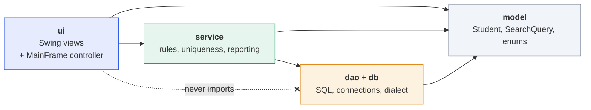
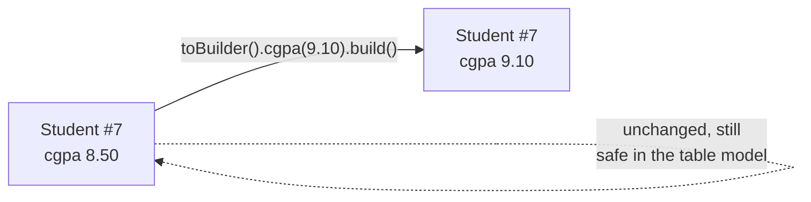
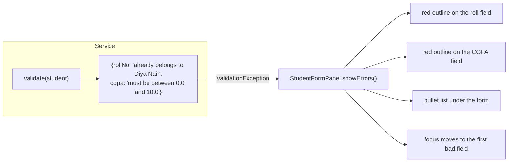
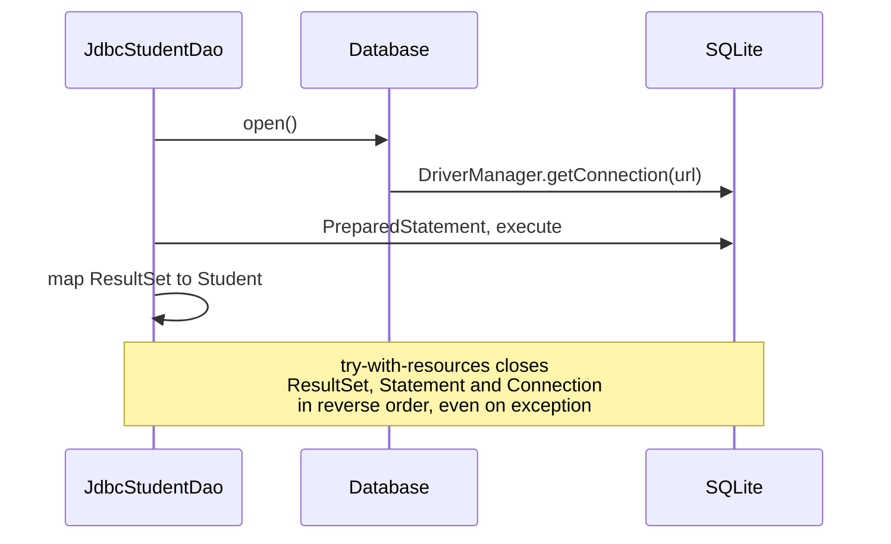
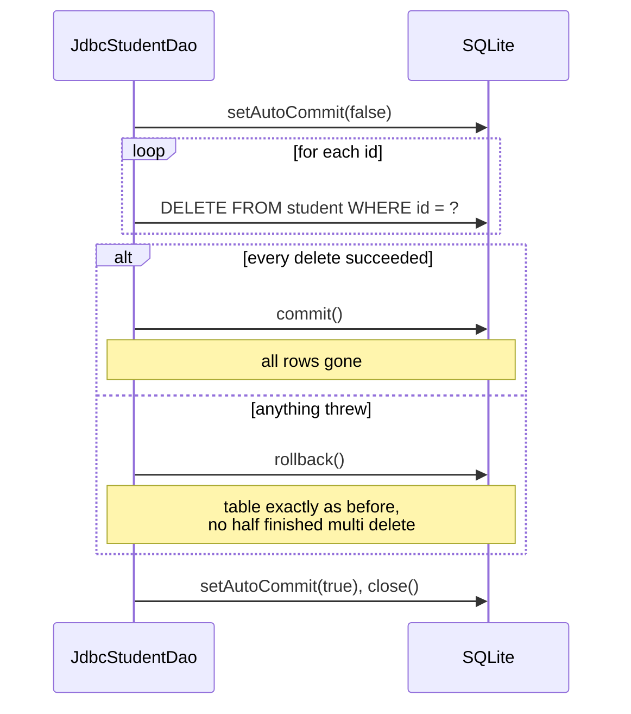
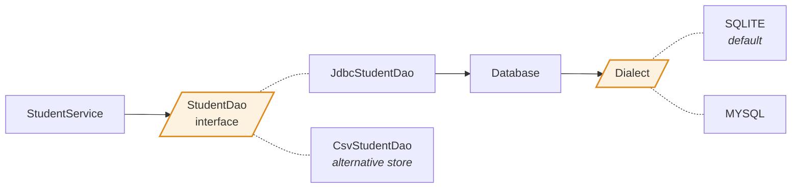
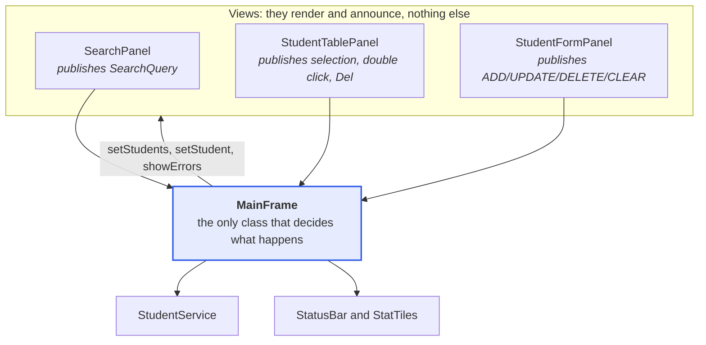
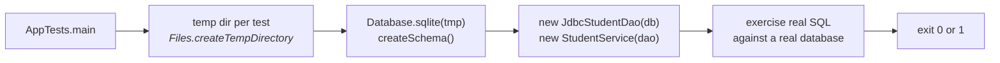

# Architecture notes

Design decisions behind the Student Management System, and the reasoning for each one. Start
with the [README](../README.md) for the feature tour; this document is the *why*.

---

## 1. Four layers, one dependency direction



Two rules keep this honest, and both are checkable with a grep:

1. **No package under `ui` imports anything from `dao`, `db` or `java.sql`.** The view cannot
   reach the database even by accident; it must go through the service, which is where the rules
   live.
2. **No package under `service`, `dao`, `db` or `model` imports `javax.swing` or `java.awt`.**
   That is what lets [AppTests](../test/com/sms/AppTests.java) exercise every rule headlessly.

`SearchQuery` sits in `model` rather than in `service` for exactly this reason. The DAO turns a
`SearchQuery` into a WHERE clause, so if the type lived in `service` the arrow between service
and dao would point both ways. As a model type it is shared without creating a cycle.

---

## 2. Why the model is immutable

`Student` has no setters. A new value means a new object, built from `toBuilder()`.



Three problems this removes outright:

* **Stale renders.** `StudentTableModel` holds the objects the DAO returned. If those objects
  could mutate, the grid would silently disagree with the database.
* **Half applied edits.** A failed validation cannot leave a record partly updated, because the
  candidate object is separate from the stored row until the UPDATE succeeds.
* **Accidental aliasing.** Handing the same `Student` to the form, the grid and the exporter is
  free; none of them can affect the others.

The cost, one allocation per edit, is irrelevant at this scale.

---

## 3. Validation belongs to the service, not the form and not the database

A tempting shortcut is to validate inside the Swing listeners. This application does not,
because the form is only *one* possible caller: the test suite, the sample data seeder and any
future importer call `StudentService.add` directly and must get identical guarantees.

The contract is a field keyed map, which is what makes rich UI feedback possible without the
service knowing that a UI exists:



Two details that matter more than they look:

* **Every problem is collected before throwing.** Users should not fix one field, press Add, and
  discover the next. `validate` fills a `LinkedHashMap` and throws once, in form order.
* **Normalisation runs before validation.** `" 23cse101 "` is trimmed and upper cased *first*,
  so the uniqueness check compares like with like and the stored data stays canonical.

### Defence in depth

Uniqueness is enforced twice on purpose.

| Layer | Mechanism | What it is for |
|---|---|---|
| Service | `findByRollNo`, `findByEmail` before insert | A friendly message naming the student who already holds that roll number |
| Database | `UNIQUE` on `roll_no` and `email` | The actual guarantee, including against a second client or a race |

The service check is a courtesy; the index is the contract. `AppTests` inserts a duplicate
straight through the DAO, bypassing the service, to prove the index really fires and that the
vendor error is translated into a readable sentence.

Uniqueness comparisons use `clash.getId() != student.getId()`, so a record may always keep its
own roll number and email during an update. That is the case a naive `contains` check gets
wrong, and there is a test for it.

---

## 4. The data access layer

### Every value is a bound parameter

There is no string concatenation of user input anywhere in `JdbcStudentDao`, including in the
dynamic search. The clause text is assembled from constants; values travel separately:

```java
if (query.hasKeyword()) {
    sql.append(" AND (LOWER(roll_no) LIKE ? OR LOWER(name) LIKE ? OR ...)");
    parameters.add("%" + query.getKeyword().toLowerCase(Locale.ROOT) + "%");
}
```

This is not a style preference. `AppTests` fires `' OR '1'='1` and `x'; DROP TABLE student; --`
through the search box and asserts that both match zero rows and that the table is still intact
afterwards. With concatenation those tests would fail, loudly.

The one place a column name is interpolated, `findByUniqueColumn`, receives one of two
hard coded constants chosen by the calling method. That is documented at the call site, because
"it looks like string building in SQL" deserves an explanation.

### Connections

Each operation opens and closes its own `Connection` through try-with-resources:



For a single user desktop application against a local file this is both simple and fast. A
server side application would put a pool such as HikariCP in front of `Database.open()` and
change nothing else, which is precisely why that method exists rather than scattering
`DriverManager` calls through the DAO.

### Transactions

`deleteMany` is the one operation that touches several rows, so it is the one that needs to be
atomic:



Auto-commit is restored in a `finally` block before the connection is closed. That matters the
moment a pool is introduced: a pooled connection handed back with auto-commit still off will
quietly break the next borrower.

### Dates as ISO text, not java.sql.Date

`java.sql.Date` carries the JVM default time zone and can shift a date of birth by a day across
a DST boundary. Binding `yyyy-MM-dd` as a string avoids the whole category: SQLite stores the
text as given, MySQL parses it into a `DATE` column and returns the same text. There is a test
asserting the exact date survives a round trip.

### Aggregates run in the database

The four dashboard tiles are four aggregate queries (`COUNT(*)`, `AVG(cgpa)`, `GROUP BY
department`, `ORDER BY cgpa DESC LIMIT 1`) rather than a scan in Java. At eight rows it makes no
measurable difference; at eighty thousand it is the difference between a snappy dashboard and a
frozen window. `AVG` over zero rows returns SQL NULL, which `getDouble` reports as `0.0`, and
there is a test pinning that behaviour so an empty database never shows `NaN`.

---

## 5. Portability: SQLite today, MySQL by configuration



Only three things actually differ between the two databases, and all three live in
[Dialect.java](../src/com/sms/db/Dialect.java):

| Difference | SQLite | MySQL |
|---|---|---|
| Identity column | `INTEGER PRIMARY KEY AUTOINCREMENT` | `INT AUTO_INCREMENT PRIMARY KEY` |
| Column types | `TEXT`, `REAL` | `VARCHAR(n)`, `DECIMAL(4,2)`, `DATE` |
| Unique violation | `getErrorCode() == 19`, SQLState null | `getErrorCode() == 1062`, SQLState `23000` |

Case insensitive uniqueness needed care. MySQL collations are case insensitive by default while
SQLite compares text as bytes, so the SQLite schema declares `COLLATE NOCASE` on `roll_no` and
`email`. The two databases then agree that `23cse101` and `23CSE101` are the same key, and a
plain `WHERE roll_no = ?` is case insensitive on both while still using the index. Writing
`UPPER(roll_no) = UPPER(?)` would also work but would throw the index away.

The migration itself is one edit to `db.properties` plus one jar in `lib/`. No Java changes.

---

## 6. Why a second, non SQL store still exists

`CsvStudentDao` predates the database and was deliberately kept.

It is the load bearing evidence for the central architectural claim. Anyone can *say* their DAO
interface is swappable; this project runs one full scenario through both implementations and
asserts they return identical answers:

```java
checkEquals("same row count",   sqlite.count(),            csv.count());
checkEquals("same average",     sqlite.averageCgpa(),      csv.averageCgpa());
checkEquals("same topper",      sqlite.findTopper(),       csv.findTopper());
checkEquals("same search result for query " + n,
            rollNumbers(sqlite.search(q)), rollNumbers(csv.search(q)));
```

If a SQL `WHERE` clause and the in-memory `SearchQuery.matches` rules ever drift apart, that test
fails. The service, the validation, the dashboard and every Swing panel run unchanged on either
store, which is the claim, demonstrated rather than asserted.

It also keeps `SearchQuery.matches(Student)` honest as executable documentation of what the SQL
is supposed to mean.

---

## 7. The UI layer

### Passive views, one controller



No panel holds a reference to another panel. `SearchPanel` does not know a table exists; it
publishes a `SearchQuery` and stops. That is why the form could be dropped into a dialog, or the
table reused in a read only report, without edits.

### One refresh path

Every mutation ends in the same method:

```java
refresh(message, level)
  -> service.search(currentQuery)      // re-apply the active filters, in SQL
  -> tablePanel.setStudents(rows, ...) // repaint, restoring the selection by id
  -> updateDashboard()                 // four aggregate queries
  -> statusBar.setMessage(...)
```

A single path means a newly added student that does not match the active filter simply does not
appear, correctly, with no special case anywhere.

### Threading

Swing is single threaded and this application obeys that:

* `Main` builds the window inside `SwingUtilities.invokeLater`.
* The clock uses `javax.swing.Timer`, which fires on the EDT, not `java.util.Timer`, which
  would not.
* Database calls are small, synchronous and local. This is the honest limitation: against a
  remote MySQL server a slow query would briefly freeze the window. The fix is a `SwingWorker`
  per operation with the buttons disabled while one is in flight, and because every action
  funnels through `MainFrame`, that change lands in one file.

### Look and feel

`Theme` centralises the palette, the type scale and the spacing steps, and `Theme.install()`
seeds `UIManager` defaults so even the components it does not paint (menus, tooltips, option
panes) match. `ActionButton`, `CardPanel`, `StatTile` and `GradientPanel` paint themselves with
antialiased `Graphics2D`, always on a `Graphics` copy disposed in a `finally` block.

Two bugs found by actually looking at screenshots during development, both worth remembering:

* A `JSlider` has a tiny minimum size, so `GridBagLayout` squashed the CGPA filter to a stub as
  soon as the bar got tight. Fixed by pinning its minimum size to its preferred size.
* `HintTextField` left a stale placeholder painted underneath the caret, because Swing repaints
  only the one pixel caret region on a focus change. Fixed with a `FocusListener` that calls
  `repaint()`, and the hint is now drawn at `insets + margin` so the text does not jump two
  pixels when the user starts typing.

---

## 8. Testing without a build tool

No Maven, no Gradle, no JUnit jar: the project has to run from a bare JDK plus one driver.
[AppTests](../test/com/sms/AppTests.java) is therefore a plain `main` with `check` and
`checkEquals` helpers, printing a PASS or FAIL line each and exiting non zero if anything fails,
which is all a CI step would need.



The tests run against a real SQLite file rather than a mock. That is the point: a mocked DAO
would happily agree with whatever the test expected, and would never have caught a wrong column
name, a broken WHERE clause or an unenforced index. Each test gets its own temporary file, so
they are order independent and leave nothing behind.

---

## 9. Known limits

Honest list, in the order they would be worth fixing:

| Limit | Consequence | Fix |
|---|---|---|
| No undo | A confirmed delete is final | A bounded command stack in `MainFrame` |
| Synchronous JDBC on the EDT | A slow or remote database would freeze the window | `SwingWorker` per operation |
| A connection per operation | Fine for a local file, wasteful over a network | A connection pool behind `Database.open()` |
| No pagination | The grid loads every matching row | `LIMIT` and `OFFSET`, plus a page control |
| Single user, no optimistic locking | Two instances could overwrite each other's edits | A `version` column checked in the `WHERE` of the UPDATE |
| Passwords and auth absent | Anyone who can run the app can edit any record | Out of scope for this assignment |
| No photo or document attachments | Text records only | A `BLOB` column and a `JFileChooser` |
